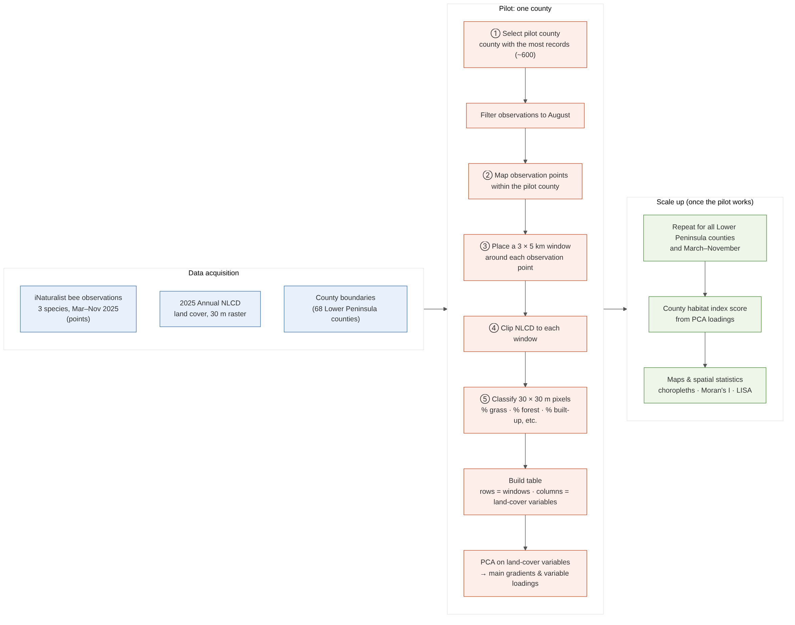

# Bee Observations and Habitat Connectivity in Michigan's Lower Peninsula

EAS 543: Environmental Spatial Analysis (Fall 2026), University of Michigan
Team: Claire Ye, Minhai Li, Owen Widdis

We test whether regions of similar habitat connectivity and fragmentation differ in
bee observation rates. Species: *Apis mellifera*, *Bombus impatiens*, *Xylocopa virginica*.
Pilot: Kent County, August 2025. Scale-up: all 68 Lower Peninsula counties, March–November 2025.



## Repository structure

```
python/inat_bees_to_df.py      Pull iNaturalist observations into data/raw/
R/00_setup.R                   Install and load packages
R/01_prepare_data.R            Clean observations, pilot county, 3 x 5 km grid, counts per cell
R/02_habitat_layers.R          Clip NLCD, habitat raster, road barriers, habitat patches
R/03_connectivity_metrics.R    % habitat, cohesion, mesh size, distance, IIC, PC per cell
R/04_regionalization.R         PCA, spatially constrained regionalization, compare bee rates
data/raw/                      Downloaded data (not committed, see below)
data/processed/                Intermediate outputs (not committed)
outputs/figures/               Maps and charts
docs/                          Flowchart, notes, definitions
```

Run the scripts in order. Each R script reads what the previous one wrote to `data/processed/`.

## Data (download into `data/raw/`)

Large files are excluded by `.gitignore`. Each teammate downloads them locally.

| Dataset | Source | Save as |
|---|---|---|
| iNaturalist bee observations | `python python/inat_bees_to_df.py` | `data/raw/inat_bees_MI_2025.csv` |
| 2025 Annual NLCD land cover (Collection 1.2) | USGS, https://doi.org/10.5066/P94UXNTS | `data/raw/Annual_NLCD_LndCov_2025_CU_C1V2.tif` |
| TIGER/Line 2025 counties | https://www.census.gov/geographies/mapping-files/time-series/geo/tiger-line-file.html | `data/raw/tl_2025_us_county/` |
| TIGER/Line 2025 roads, Kent County (FIPS 26081) | same as above, Roads | `data/raw/tl_2025_26081_roads/` |
| County population estimates (CO-EST2025-alldata) | https://www.census.gov/data/datasets/time-series/demo/popest/2020s-counties-total.html | `data/raw/co-est2025-alldata.csv` |

## Key definitions (draft)

- **Habitat:** NLCD shrub/scrub (52), grassland/herbaceous (71), pasture/hay (81). Revisit per species.
- **Connectivity:** functional; habitat patches count as connected within a bee foraging
  distance (1,000 and 3,000 m thresholds).
- **Projection:** all layers in the NLCD's Albers Equal Area (WGS84 datum), units in meters.

## Setup

R 4.3+ and Python 3.10+. Run `Rscript R/00_setup.R` once. Python needs `requests` and `pandas`.

## Status

The R scripts are a starting skeleton and have not been run yet. Lines marked `TODO` need checking
against package documentation, especially the `lconnect` and `Makurhini` calls.
# eas-543-beeconnectivity
